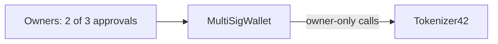

# Architecture

## Components

### `Tokenizer42`

`code/contracts/Tokenizer42.sol` combines OpenZeppelin Contracts v5 building blocks:

- `ERC20` supplies balances, transfers, approvals, allowances, and standard events.
- `ERC20Burnable` adds `burn` and `burnFrom`.
- `ERC20Capped` enforces the 42,000,000 TK42 maximum supply.
- `ERC20Pausable` blocks balance changes while paused.
- `Ownable` protects `mint`, `pause`, and `unpause` and permits ownership transfer.

The constructor takes `initialOwner` and `initialSupply`, names the token `Tokenizer 42` / `TK42`, and mints the initial amount to the owner. `_update` resolves the cap and pause checks from its parent contracts. The token has no custom transfer fee, blacklist, proxy, or upgrade path.

### `MultiSigWallet` bonus

The bonus contract is a small wallet controlled by a list of owners and a required approval threshold. An owner submits a destination, native coin value, and call data. Owners confirm or revoke confirmation. Only owners can submit, confirm, revoke, or execute. A successful execution is marked before the external call, and a reentrancy lock blocks nested execution.

The bonus deployment transfers `Tokenizer42` ownership to the multisig. The multisig then calls the token as its owner, so each privileged token action needs the configured number of owner approvals.

## Ownership and call flow

Before the bonus, the deployer account is the token owner. After the bonus, the owner role belongs to `MultiSigWallet`; token actions pass through its approval process.

## Important functions

| Contract | Function | Caller | Effect |
|---|---|---|---|
| Tokenizer42 | `transfer`, `approve`, `transferFrom` | Any holder / approved spender | Standard token movement and allowance behavior |
| Tokenizer42 | `mint` | Current owner | Creates tokens below the cap |
| Tokenizer42 | `burn`, `burnFrom` | Holder / approved spender | Destroys tokens |
| Tokenizer42 | `pause`, `unpause` | Current owner | Stops or resumes balance changes |
| MultiSigWallet | `submitTransaction` | Owner | Stores a proposed call and counts the submitter’s confirmation |
| MultiSigWallet | `confirmTransaction`, `revokeConfirmation` | Owner | Adds or removes the caller’s approval |
| MultiSigWallet | `executeTransaction` | Owner | Calls the destination after the threshold is met |

## Events

The token emits standard `Transfer`, `Approval`, `Paused`, `Unpaused`, and `OwnershipTransferred` events. The multisig emits events when transactions are submitted, confirmed, revoked, and executed, and when native coin is received.
